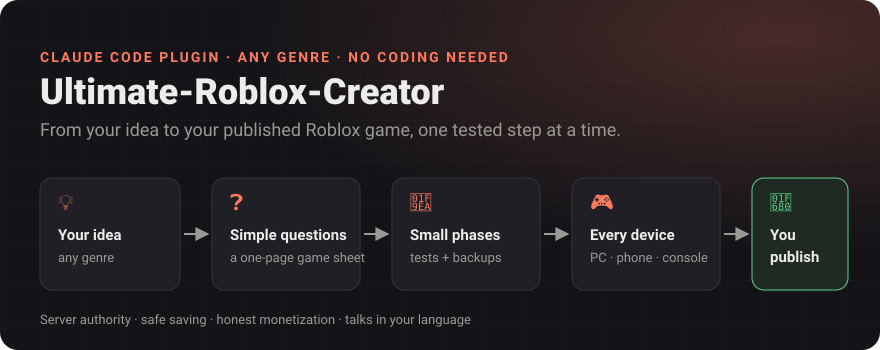

<div align="center">



<p>
  <a href="https://github.com/trevanix/ultimate-roblox-creator/actions/workflows/tests.yml"></a>
  
  
  
  <a href="LICENSE"></a>
</p>

<p>
  <b><a href="#start-here">Start here</a></b> ·
  <a href="#works-with">Codex · Gemini · Antigravity</a> ·
  <a href="#what-it-does">What it does</a> ·
  <a href="#skills-and-agents">Skills and agents</a> ·
  <a href="#faq">FAQ</a> ·
  <a href="https://trevanix.github.io/ultimate-roblox-creator/">Website</a> ·
  <a href="#español">Español</a>
</p>

</div>

**Make your own Roblox game with AI, even if you can't code.** Ultimate-Roblox-Creator is a free
[Claude Code](https://claude.com/claude-code) plugin that walks you from idea to published game: it asks
what you want to build, writes the Luau code, tests every step, and makes it work on **computer, phone,
tablet and console**. Any genre: obby, tycoon, simulator, horror, RPG, racing, survival or something new.
It talks to you in your language with plain words. **You always publish**; Claude never publishes your place.

The instructions are written in Spanish and the plugin replies in your language (English, Spanish,
Portuguese…). It works with the Roblox Studio MCP server, or without it by giving you code to paste.

## Start here

You need an AI coding agent ([Claude Code](https://claude.com/claude-code) gets everything; Codex, Gemini CLI
and Antigravity get the skills, see [Works with](#works-with)) and [Roblox Studio](https://create.roblox.com).
With Claude Code, in a terminal:

```
claude plugin marketplace add trevanix/ultimate-roblox-creator
claude plugin install ultimate-roblox-creator@trevanix
```

Open a new Claude Code session and say what you want, for example:

> I want to make a Roblox game where you're a penguin delivering pizzas in an ice city. I can't code.

Or call it directly: `/ultimate-roblox-creator:ultimate-roblox-creator`.

**Only for one folder** (keeps your other sessions untouched): run both commands inside that folder with
`--scope local`. **Try without installing**: download the repo and run
`claude --plugin-dir ./ultimate-roblox-creator`. **Remove**: `claude plugin uninstall ultimate-roblox-creator@trevanix`.

## Works with

The 13 skills use the open Agent Skills format (a folder with a `SKILL.md`), so
they also work outside Claude Code. The one-command install and the 4 reviewer agents are Claude Code only;
elsewhere the director does those reviews itself.

| Tool | Skills | Agents | Install |
|---|---|---|---|
| **Claude Code** | ✅ 13 | ✅ 4 | `claude plugin install` (see [Start here](#start-here)) |
| **OpenAI Codex** | ✅ 13 | — | copy to `~/.agents/skills/` |
| **Gemini CLI** | ✅ 13 | — | copy to `~/.agents/skills/` |
| **Google Antigravity** | ✅ 13 | — | copy to `~/.gemini/config/skills/` (or `.agents/skills/` in your project) |

Copy the skills (Windows PowerShell):

```powershell
git clone https://github.com/trevanix/ultimate-roblox-creator
New-Item -ItemType Directory -Force "$HOME\.agents\skills" | Out-Null
Copy-Item -Recurse -Force ultimate-roblox-creator\ultimate-roblox-creator\skills\* "$HOME\.agents\skills\"
```

macOS / Linux:

```bash
git clone https://github.com/trevanix/ultimate-roblox-creator
mkdir -p ~/.agents/skills && cp -R ultimate-roblox-creator/ultimate-roblox-creator/skills/* ~/.agents/skills/
```

For **one project only**, copy them to `.agents/skills/` inside that project instead (all three tools read
it). For **Antigravity's global folder**, use `~/.gemini/config/skills/` instead of `~/.agents/skills/`.
Then start a new session (in Gemini CLI or Antigravity CLI, `/skills reload`) and describe your game idea.
Codex can also be told `$ultimate-roblox-creator`.

Folders are from each tool's official docs (checked 2026-11-18): [Codex](https://learn.chatgpt.com/docs/build-skills),
[Gemini CLI](https://geminicli.com/docs/cli/skills/), [Antigravity](https://antigravity.google/docs/skills).
Only Claude Code has been tested end to end so far; reports from other tools are welcome.

To connect Roblox Studio, set up the Roblox Studio MCP server in your tool. Without it, the skills give
you code to paste.

## What it does

The plugin follows six stages and tells you where you are:

1. **Idea**: questions about your game, two or three at a time, until a one-page game sheet is clear
   (core loop, saving, multiplayer, age, devices, monetization). It never forces a genre and always looks
   for *something different*.
2. **Design**: numbered decisions, each with a recommendation and its cost. You choose.
3. **Plan**: small phases you can test one by one. The core loop comes first, playable even if ugly.
4. **Build**: for each phase, automated tests, an independent review by another agent, and a backup
   before anything touches player data.
5. **Devices and text**: one UI scale for computer, phone and console; gamepad glyphs (PS5 / Xbox);
   readable text on phones; wording that fits your players' age.
6. **Publish**: a checklist, the game page and the maturity questionnaire. **You** press Publish.

It carries lessons from a real published Roblox game: server authority, session-locked DataStores with
migrations, idempotent `ProcessReceipt`, honest monetization for kids, StreamingEnabled and building only
nearby, no free Toolbox models (they can hide backdoors), and never an unbounded `repeat … until`.

## When to use · when to skip

- **Use it** to start a new Roblox game, continue one, add a system (saving, shop, NPCs, phone UI), or check
  a game before publishing.
- **Skip it** for one-off Luau API questions, or for Unity, Godot and other engines.

## Skills and agents

| Skill | What for |
|---|---|
| `ultimate-roblox-creator` | The director: your idea, the game sheet, decisions, tested phases, up to publishing. Loads the others |
| `rc-datos` | Saving progress without ever losing it |
| `rc-servidor` | Secure remotes, anti-cheat with sensible margins |
| `rc-interfaz` | Screens for computer, phone, tablet and console |
| `rc-personajes-fisica` | Characters, respawns, collisions, fast projectiles |
| `rc-economia` | Currencies, price curves, upgrades and honest sales |
| `rc-mundo` | Level design, pacing and performance on cheap phones |
| `rc-sensacion` | Game feel and camera, without making anyone dizzy |
| `rc-npc` | Enemies, pets, pathfinding and dialogue |
| `rc-generos` | Questions and numbers per genre (you choose) |
| `rc-prototipo` | Test one idea in about an hour, and a one-page game doc |
| `rc-sonido` | Music and sound effects with valid licenses |
| `rc-publicar` | Publishing step by step (you do it) |

| Agent | What for | Can |
|---|---|---|
| `revisor-seguridad-datos` | Review remotes, saving and purchases | Read only |
| `revisor-textos-ventas` | Age-appropriate text, honest sales, content ratings | Read only |
| `probador-studio` | Run the test battery and Play tests | Runs tests in Studio; never edits, saves or publishes |
| `buscador-audio` | Find sounds with valid licenses (Roblox, Openverse) | Searches the web; downloads nothing |

## FAQ

### Can I make a Roblox game with AI if I don't know how to code?
Yes. You describe the game and make the decisions; Claude writes and tests the code and tells you exactly
what to click in Roblox Studio, one action at a time.

### Does it only make simulators or "+1" games?
No. There are no closed templates. It asks about your idea first; the genre notes are only questions and
ideas.

### Will it publish my game or spend my Robux?
No. Publishing, prices and putting items on sale are always done by you. Claude never saves or publishes
your place unless you ask for that specific action.

### Does it work with Codex, Gemini CLI or Antigravity?
Yes, the 13 skills do: copy them to `~/.agents/skills/` (see [Works with](#works-with)). The one-command
install and the 4 reviewer agents are Claude Code only.

### Does it work without the Roblox Studio MCP?
Yes. Without it, Claude gives you each script, tells you where it goes and what you should see when you
test.

### Is it safe for kids' games?
It is designed for that: text by age, no pressure to buy, odds shown before any paid random item, and
`PolicyService` checks. You still answer Roblox's maturity questionnaire yourself.

### How was it tested?
82 activation phrases in Spanish, English and Portuguese, judged by two independent models (100% on
"should" and "near-miss" cases), `claude plugin validate`, and real runs of the director, three skills and
three agents. Results are in [`ultimate-roblox-creator/pruebas/`](ultimate-roblox-creator/pruebas/).

## Development

- Plugin files live in [`ultimate-roblox-creator/`](ultimate-roblox-creator/); the marketplace is
  [`.claude-plugin/marketplace.json`](.claude-plugin/marketplace.json).
- `node scripts/check.mjs` checks the manifests, names, descriptions and links (it runs on every push).
- `claude plugin validate ./ultimate-roblox-creator` checks the plugin with Claude Code.
- AI agents working on this repo: read [`AGENTS.md`](AGENTS.md).

## Credits

- [gamedev-skills/awesome-gamedev-agent-skills](https://github.com/gamedev-skills/awesome-gamedev-agent-skills)
  (Apache-2.0): the director-and-small-skills method, skill format and activation tests. Rewritten in our own
  words; see [NOTICE](NOTICE).
- Sound sources described in `rc-sonido`: [earshot](https://github.com/Leonxlnx/earshot),
  [Clipwing/skills](https://github.com/Clipwing/skills) and [Openverse](https://openverse.org). Nothing of
  theirs is bundled.

Made by [Trevanix](https://github.com/trevanix). Questions: [contact@trevanix.com](mailto:contact@trevanix.com) ·
security reports: [security policy](https://github.com/trevanix/.github/blob/main/SECURITY.md).

Not affiliated with Roblox Corporation or Anthropic. Roblox is a trademark of Roblox Corporation.

---

## Español

**Crea tu propio juego de Roblox con IA, aunque no sepas programar.** Ultimate-Roblox-Creator es un plugin
gratuito de [Claude Code](https://claude.com/claude-code) que te acompaña de la idea al juego publicado: te
pregunta qué quieres hacer, escribe el código en Luau, prueba cada paso y lo deja listo para **ordenador,
teléfono, tableta y consola**. De cualquier género: obby, tycoon, simulador, terror, RPG, carreras,
supervivencia o algo nuevo. Habla contigo en tu idioma y con palabras sencillas. **Publicas tú siempre.**

### Cómo empezar
Necesitas Claude Code y Roblox Studio. En una terminal:

```
claude plugin marketplace add trevanix/ultimate-roblox-creator
claude plugin install ultimate-roblox-creator@trevanix
```

Abre una sesión nueva de Claude Code y cuéntale tu idea: «Quiero hacer un juego de Roblox de un pingüino
que reparte pizzas. No sé programar». También puedes llamarlo con `/ultimate-roblox-creator:ultimate-roblox-creator`.

Solo para una carpeta (no toca tus otras conversaciones): los dos comandos dentro de esa carpeta, con
`--scope local`. Para quitarlo: `claude plugin uninstall ultimate-roblox-creator@trevanix`.

### Funciona con Codex, Gemini CLI y Antigravity
Las 13 skills usan el formato abierto de skills (una carpeta con `SKILL.md`), así que también sirven fuera
de Claude Code. La instalación con dos comandos y los 4 agentes revisores son solo de Claude Code; en las
demás, la skill directora hace esas revisiones ella misma.

- **Codex y Gemini CLI:** copia las skills a `~/.agents/skills/`.
- **Antigravity:** a `~/.gemini/config/skills/` (global) o a `.agents/skills/` dentro de tu proyecto.
- **Solo un proyecto (las tres):** a `.agents/skills/` dentro de ese proyecto.

En Windows (PowerShell):

```powershell
git clone https://github.com/trevanix/ultimate-roblox-creator
New-Item -ItemType Directory -Force "$HOME\.agents\skills" | Out-Null
Copy-Item -Recurse -Force ultimate-roblox-creator\ultimate-roblox-creator\skills\* "$HOME\.agents\skills\"
```

Después abre una sesión nueva (en Gemini CLI o Antigravity CLI, `/skills reload`) y cuéntale tu idea.
Por ahora solo está probado de principio a fin en Claude Code.

### Qué hace
1. **La idea:** preguntas de 2 en 2 o de 3 en 3 hasta tener la ficha del juego. Nunca impone un género.
2. **El diseño:** decisiones numeradas con una recomendación. Tú eliges.
3. **El plan:** fases pequeñas que se prueban solas.
4. **Construir:** pruebas automáticas, revisión de otro agente y respaldo antes de tocar datos.
5. **Dispositivos y textos:** ordenador, teléfono y consola; textos según la edad de tus jugadores.
6. **Publicar:** lista, página del juego y cuestionario de madurez. **Publicas tú.**

Lleva las lecciones de un juego de Roblox real ya publicado: el servidor manda, guardado con bloqueo de
sesión y migraciones, compras que nunca se entregan dos veces, ventas honestas con niños, mapas grandes
que no se traban y nada de modelos gratis de la Caja de herramientas (pueden traer puertas traseras).

### Preguntas frecuentes
- **¿Publica mi juego o gasta mis Robux?** No. Publicar, poner precios y poner cosas a la venta lo haces tú.
- **¿Funciona sin el MCP de Roblox Studio?** Sí: te da el código, te dice dónde va y qué deberías ver.
- **¿Sirve en Codex, Gemini o Antigravity?** Sí, las 13 skills (sin los agentes): ver arriba.
- **¿Solo hace simuladores?** No. Primero pregunta tu idea; los géneros son solo ideas y preguntas.

Hecho por [Trevanix](https://github.com/trevanix). Contacto: [contact@trevanix.com](mailto:contact@trevanix.com).
No está afiliado a Roblox Corporation ni a Anthropic.
